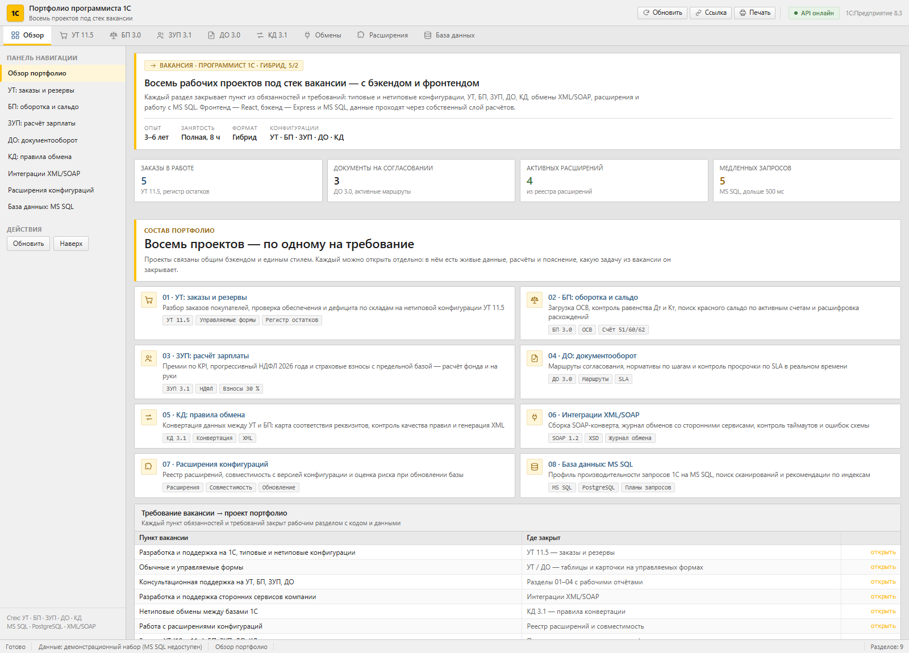
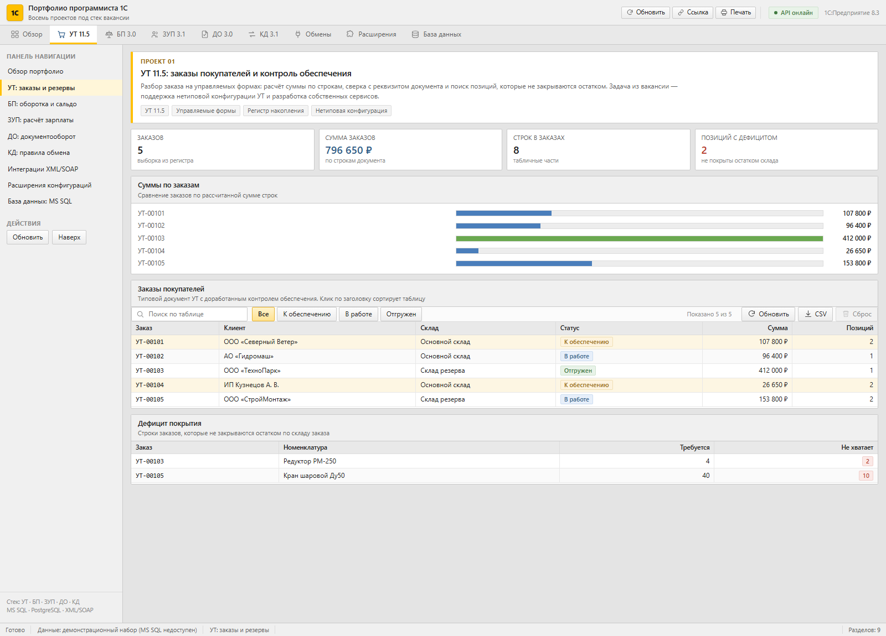
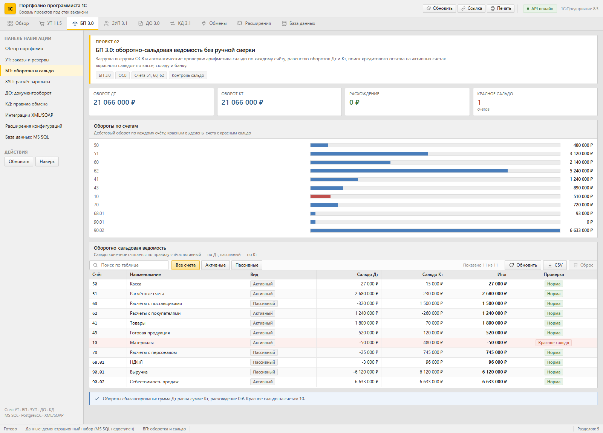
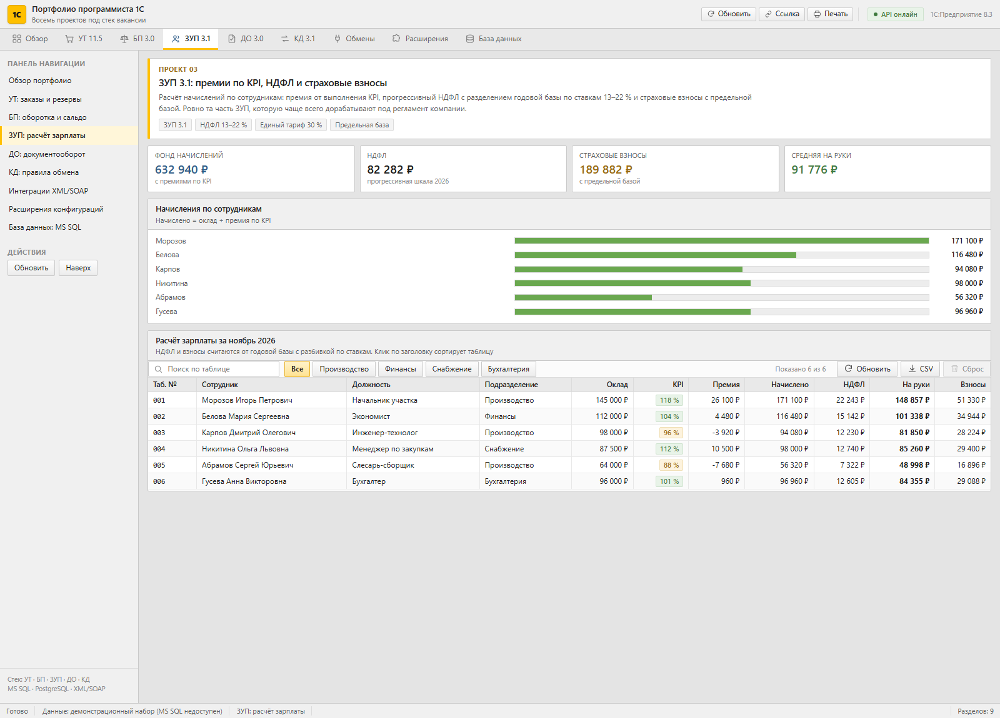
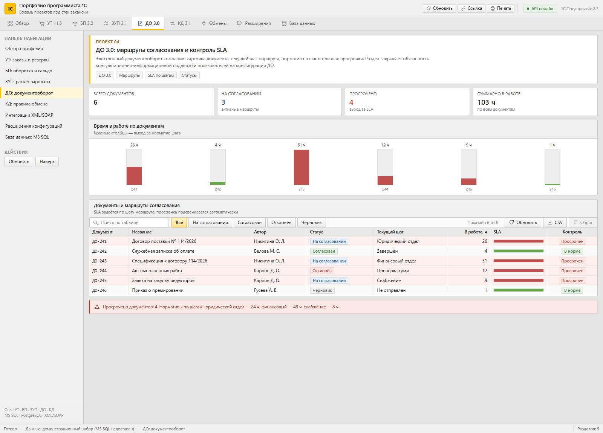
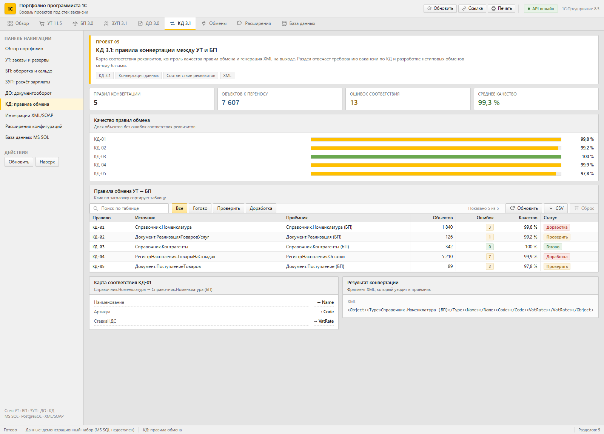
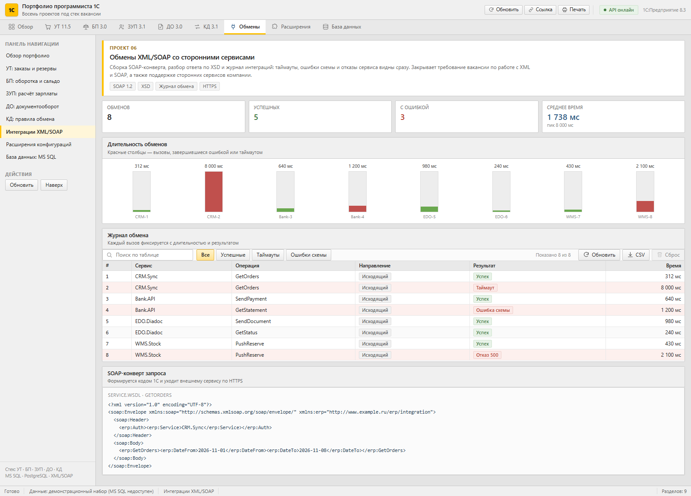
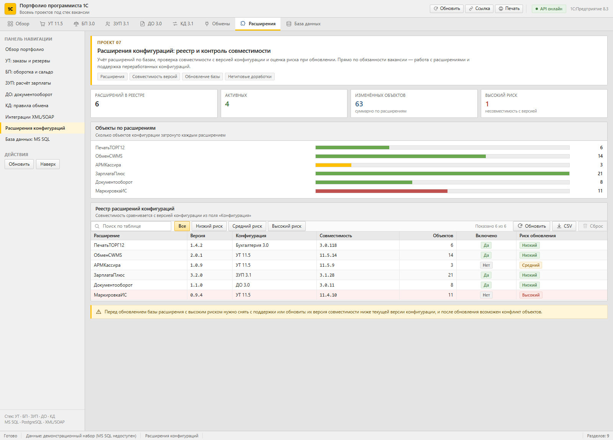
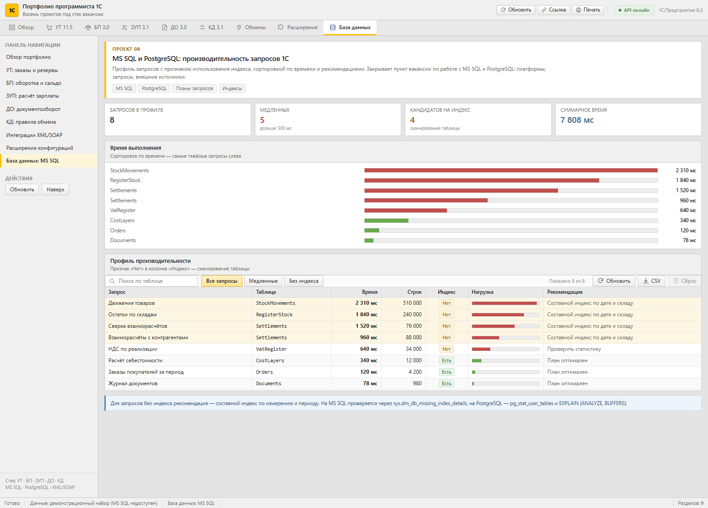

# Портфолио программиста 1С

Веб-приложение в стиле клиента **1С:Предприятие 8.3** (интерфейс «Такси»): восемь рабочих разделов, каждый закрывает конкретный пункт вакансии программиста 1С — от заказов в УТ до планов запросов на MS SQL.



---

## Что внутри

| # | Раздел | Конфигурация | Что делает |
|---|--------|--------------|------------|
| 01 | Заказы и резервы | УТ 11.5 | Расчёт суммы заказа по строкам, сверка с реквизитом документа, поиск дефицита по остаткам склада |
| 02 | Оборотка и сальдо | БП 3.0 | ОСВ с проверкой арифметики, равенства Дт/Кт и поиском красного сальдо по активным счетам |
| 03 | Расчёт зарплаты | ЗУП 3.1 | Премии по KPI, прогрессивный НДФЛ 13–22 %, страховые взносы с предельной базой |
| 04 | Документооборот | ДО 3.0 | Маршруты согласования, нормативы по шагам, контроль просрочки по SLA |
| 05 | Правила обмена | КД 3.1 | Карта соответствия реквизитов, качество правил конвертации, генерация XML |
| 06 | Интеграции | XML / SOAP | Сборка SOAP-конверта, журнал обменов, таймауты и ошибки схемы |
| 07 | Расширения | Расширения | Реестр расширений, совместимость версий, оценка риска при обновлении |
| 08 | База данных | MS SQL / PostgreSQL | Профиль запросов, поиск сканирований, рекомендации по индексам |

## Скриншоты

### 01 · УТ 11.5 — заказы и контроль обеспечения



### 02 · БП 3.0 — оборотно-сальдовая ведомость



### 03 · ЗУП 3.1 — премии, НДФЛ и взносы



### 04 · ДО 3.0 — маршруты и SLA



### 05 · КД 3.1 — правила конвертации



### 06 · Обмены XML/SOAP



### 07 · Расширения конфигураций



### 08 · MS SQL и PostgreSQL — производительность



---

## Интерфейс

Повторяет клиент 1С: верхняя панель с разделами, панель навигации слева, формы с серой шапкой, таблицы-сетка с чередованием строк и синим выделением, командные панели с поиском и фильтрами, строка состояния внизу. Акцентный цвет — жёлтый 1С `#FFC000`, палитра серых панелей, шрифт Segoe UI.

## Стек

- **Фронтенд** — React 18, Vite 6, собственная система компонентов на чистом CSS
- **Бэкенд** — Node.js, Express 4, `mssql`
- **БД** — MS SQL Server (схема и сид-данные готовы), fallback на встроенный набор
- **Тесты** — встроенный `node:test`, 362 теста
- **Линтер** — ESLint 9 с собственными правилами

## Быстрый старт

```bash
npm install
npm run dev          # API на :4000 + Vite на :5173
```

Продакшн-сборка:

```bash
npm run build
npm start            # http://localhost:4000
```

### Подключение MS SQL

Параметры подключения — в `.env` (см. `.env.example`). Если сервер недоступен, API автоматически работает на встроенном наборе данных, и интерфейс полностью функционален.

```bash
npm run db:init      # создать базу, таблицы и залить сид-данные
```

## Скрипты

| Команда | Что делает |
|---------|------------|
| `npm run dev` | API + фронтенд в режиме разработки |
| `npm run build` | Сборка фронтенда в `dist/` |
| `npm start` | Express отдаёт API и собранный фронтенд |
| `npm test` | 362 теста (`node --test`) |
| `npm run lint` | ESLint по всему проекту |
| `npm run db:init` | Создание схемы и данных в MS SQL |

## Тесты

```
ℹ tests 362
ℹ pass 362
ℹ fail 0
```

Покрытие по слоям:

- `tests/unit/` — доменные расчёты: НДФЛ по 21 базе, взносы, премии, сальдо по 11 счетам, дефицит, SLA, качество правил, версии расширений, метрики запросов
- `tests/api/` — 26 проверок HTTP: все эндпоинты, POST резерва, 404 на неизвестный маршрут
- `tests/data/` — целостность справочников: уникальность ключей, состав колонок, ссылочная целостность

## Правила кода

Линтер настроен жёстко и ломает сборку при нарушении:

- **один выход из функции** — собственное правило `local/single-exit` (ровно один `return`)
- **функция — 1–2 оператора** — `max-statements: 2`
- **запрещены** `for`, `for-in`, `for-of`, `while`, `do-while`, `break`, `continue`, метки
- `max-params: 3`, `complexity: 3`, `max-depth: 1`

Циклы заменены на `map` / `filter` / `reduce` и рекурсию, ветвления — на тернарные операторы и композицию функций. Правила живут в `eslint-plugin-local/`.

## Структура

```
client/src/
  components/     TopBar, Tabs, LeftPanel, StatusBar, ui, charts, toolbar
  sections/       9 разделов
  hooks.js        useApi, useUi, useView, useRoute
  state.js        стор фильтров и сортировки
  table.js        поиск, фильтрация, сортировка
  styles.css      тема 1С «Такси»
server/
  domain/         расчёты: ut, bp, zup, do, kd, soap, extensions, dbmetrics
  routes/api.js   10 эндпоинтов
  db/             подключение, схема, сид-данные
tests/            unit, api, data
eslint-plugin-local/   single-exit, jsx-uses-vars
scripts/shots.mjs      снятие скриншотов
```
